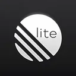
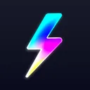
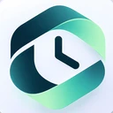

<picture>
  <source media="(prefers-color-scheme: dark)" srcset="assets/logo-dark.svg">
  
</picture>

### Your whole back office. One login, one desktop.

Transactional email, object storage + CDN, authentication, status pages, a music
studio, a WhatsApp inbox, encrypted backups, time tracking, and developer tools — tied together
by an OS-style desktop with its own App Store.

[**Website**](https://sentroy.com) · [**Docs**](https://docs.sentroy.com) · [**Desktop app**](https://sentroy.com/download) · [**Source**](https://github.com/Sentroy-Co/sentroy)

---

### One platform, a dozen products

Most teams stitch their back office together from a dozen SaaS logins. Sentroy is
that dozen — behind **one account and one desktop**:

<table>
<tr>
<td align="center" width="92"> <b>Mail</b></td>
<td align="center" width="92"> <b>Storage</b></td>
<td align="center" width="92"> <b>Auth</b></td>
<td align="center" width="92"> <b>Vault</b></td>
<td align="center" width="92"> <b>Status</b></td>
<td align="center" width="92"> <b>Studio</b></td>
</tr>
<tr>
<td align="center" width="92"> <b>WhatsApp</b></td>
<td align="center" width="92"> <b>Linear</b></td>
<td align="center" width="92"> <b>Tools</b></td>
<td align="center" width="92"> <b>Backup</b></td>
<td align="center" width="92"> <b>Video</b></td>
<td align="center" width="92"> <b>Monitor</b></td>
</tr>
</table>

### Fair Source — read every line

A platform that holds your email, files, and users' identities should be something
you can read, not just trust. Sentroy is **source-available** under the
[Functional Source License](https://github.com/Sentroy-Co/sentroy/blob/main/LICENSE):
use it, modify it, and self-host it freely.

| Repository | What it is |
|---|---|
| **[sentroy](https://github.com/Sentroy-Co/sentroy)** | The whole platform — self-host with one `docker compose` command. FSL-1.1-ALv2. |
| **[sentroy-desktop](https://github.com/Sentroy-Co/sentroy-desktop)** | Native desktop app for Windows, macOS & Linux — sentroy.com in a fast native window. FSL-1.1-ALv2. |
| **[sentroy-monitor-desktop](https://github.com/Sentroy-Co/sentroy-monitor-desktop)** | Sentroy Monitor: time and activity tracking for teams. Tray app for macOS, Windows & Linux, plus a self-hostable server. FSL-1.1-ALv2. |
| **[client-sdk](https://github.com/Sentroy-Co/client-sdk)** | Official SDKs — TypeScript, Go, Python, PHP. MIT. |
| **[create-sentroy-app](https://github.com/Sentroy-Co/create-sentroy-app)** | `npm create sentroy-app` — scaffold a Sentroy-powered app. MIT. |
| **[opencut-sentroy-edition](https://github.com/Sentroy-Co/opencut-sentroy-edition)** | The timeline video editor that slots into the desktop. |

### Two ways to run it

**Self-host** the whole thing on your own hardware, or **[use hosted plans](https://sentroy.com)**
and skip the server ops. Same code — your choice.

Fair Source, not open source · built by the Sentroy team · <a href="https://sentroy.com">sentroy.com</a>

